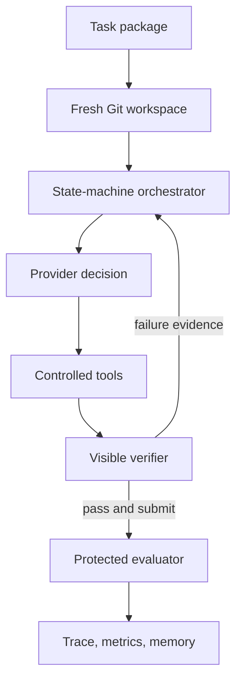
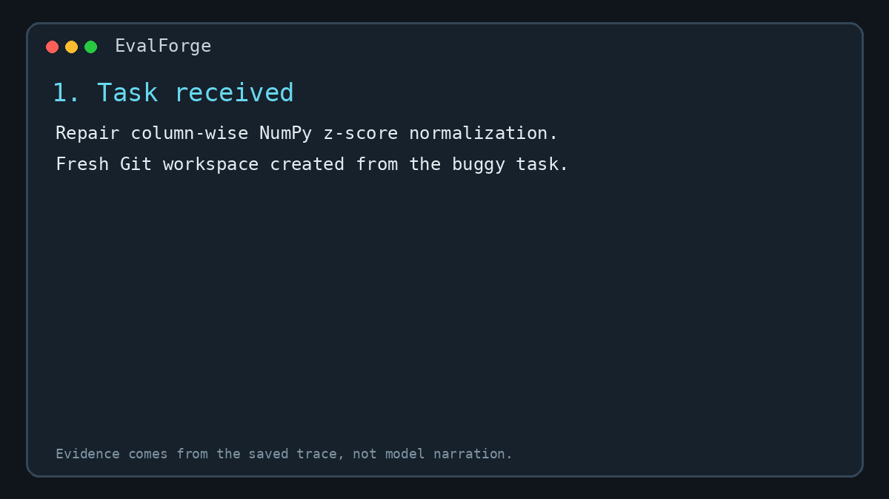

# EvalForge

**Evaluation-guided coding-agent harness for scientific Python**

EvalForge is a research harness for testing whether persistent task memory and
verifier-guided iteration improve LLM coding agents on scientific Python and ML
bug-fix tasks.

The model proposes actions. EvalForge owns execution, budgets, traces, and the
definition of success. A task is resolved only when the agent has run the
visible verifier and a separate protected evaluator also passes.

> **Research question:** Do persistent task memory and evidence-linked verifier
> iteration improve coding-agent success on scientific Python and ML repairs?

## Implemented capabilities

- Typed provider, task, action, budget, trace, verification, memory, and result contracts.
- Transparent repair state machine with explicit termination reasons.
- Repository-contained file, search, patch, shell, and test tools.
- Visible-test gate plus evaluator tests withheld until submission.
- SQLite persistent memory with FTS5 retrieval, provenance, and leakage controls.
- Evidence-linked diagnosis following observed verifier failures; see the known limitations below.
- Optional LiteLLM model adapter and credential-free scripted provider.
- Local execution and a network-disabled Docker verifier backend.
- Eight development tasks and 20 held-out evaluation tasks.
- Experiment scheduling, memory snapshots, manifests, summaries, tables, plots, and reports.
- Offline unit/integration tests and full behavioral validation of all 28 tasks.
- A reproducible demo GIF generated from an actual saved trace.

No real-model benchmark result is claimed in this repository. The checked-in
scripted experiment validates the apparatus and reference repairs; it is not a
measure of LLM ability.

## Architecture



The trust boundary is deliberate:

- Providers cannot directly call the operating system.
- Providers cannot set `resolved=true`.
- Canonical tasks are copied before modification.
- Hidden tests and reference patches never enter model context or memory.
- Memory records require trace and verifier provenance.
- The verifier-loop treatment rejects edits whose diagnosis does not cite the
  latest test output.

## Quickstart

```bash
python3.11 -m venv .venv
source .venv/bin/activate
python -m pip install -e '.[dev]'

pytest
evalforge validate-suite benchmarks/development --execute
evalforge validate-suite benchmarks/evaluation --execute
```

Run a deterministic end-to-end repair without credentials:

```bash
evalforge run-scripted benchmarks/development/task_001
```

This is an infrastructure demonstration, not a model evaluation.



## Running a real model

Install the optional adapter and configure the provider environment expected by
LiteLLM:

```bash
python -m pip install -e '.[llm,benchmark]'
evalforge run-task benchmarks/development/task_001 \
  --model YOUR_PROVIDER/YOUR_MODEL \
  --condition baseline
```

For memory-enabled conditions, supply a seeded database:

```bash
evalforge run-task benchmarks/evaluation/task_101 \
  --model YOUR_PROVIDER/YOUR_MODEL \
  --condition memory_verifier \
  --memory-db experiments/memory/frozen.sqlite
```

Use `--runner docker` after building the benchmark image:

```bash
docker build -t evalforge-bench:latest .
```

The local runner is a reproducibility boundary, not a hardened sandbox. Use the
Docker backend before executing genuinely untrusted generated code.

## Benchmark

Every task contains a buggy repository, agent-visible issue, visible tests,
protected evaluator tests, metadata, a known-good reference patch, and a
deterministic infrastructure script.

| Suite/category | Tasks |
|---|---:|
| Development memory-seeding suite | 8 |
| NumPy shapes, axes, broadcasting | 3 |
| Pandas leakage and split mistakes | 2 |
| Classification and regression metrics | 3 |
| PyTorch training, modes, gradients | 4 |
| Device and dtype handling | 2 |
| Numerical stability | 2 |
| Random seed handling | 1 |
| Scientific units and boundaries | 2 |
| Result serialization | 1 |
| **Held-out evaluation suite** | **20** |

PyTorch-loop tasks use protocol-compatible test doubles. This keeps the suite
CPU-only and lightweight while testing real control-flow requirements such as
`train()`, `eval()`, `zero_grad()`, device movement, dtype conversion, and
gradient-accumulation ordering.

## Ablation design

| Condition | Persistent memory | Required structured diagnosis |
|---|---:|---:|
| Baseline | No | No |
| Memory | Yes | No |
| Memory + verifier | Yes | Yes |

All conditions share the same model, prompts except for the treatment, starting
repository, tools, budgets, verifier, evaluator, and execution environment.
Memory must be seeded on development tasks and frozen for held-out evaluation.

Example configs are in `experiments/configs/`:

```bash
evalforge run-experiment experiments/configs/model_memory_seed.example.json
evalforge freeze-memory experiments/memory/model-seed.sqlite \
  experiments/memory/frozen.sqlite
evalforge run-experiment experiments/configs/model_evaluation.example.json
evalforge analyze experiments/runs/model-evaluation \
  --output-dir experiments/analysis/model-evaluation
```

Analysis derives these metrics from saved summaries:

- task resolution rate;
- evaluator test pass rate;
- patch validity;
- average iterations and runtime;
- token usage and estimated cost when provided;
- regression rate;
- termination-based failure taxonomy.

## Checked-in apparatus validation

The deterministic reference-provider exercise completed 60 held-out runs: 20
tasks under each of the three controller pathways. All 60 passed visible and
protected verification, and memory-enabled runs retrieved four provenance-
bearing memories each. These figures demonstrate that the harness pathways,
memory retrieval, reflection gate, evaluator overlay, and analysis pipeline
work end to end.

They must not be reported as agent performance because the scripted provider is
given the reference repair.

Compact run summaries, traces, the manifest, retrieved-memory export, CSV table,
JSON aggregate, and plot are in `experiments/artifacts/scripted-validation/`
and `experiments/analysis/scripted-validation/`.

See [docs/results.md](docs/results.md) for the generated table and
[docs/technical-report.md](docs/technical-report.md) for methodology and
limitations.

## Repository map

```text
src/evalforge/
├── orchestrator.py       # stateful control loop and success gate
├── models.py             # strict cross-component contracts
├── benchmark.py          # task loading, workspaces, behavioral validation
├── memory/               # SQLite store and leakage-aware retrieval
├── providers/            # scripted and LiteLLM provider adapters
├── runners/              # local and Docker verification backends
├── tools/                # contained file, patch, shell, and test tools
├── experiment.py         # controlled schedule and run manifest
└── evaluation.py         # trace-derived metrics, CSV, plots, report

benchmarks/
├── development/          # 8 tasks used to build/seed the system
└── evaluation/           # 20 held-out tasks
```

## Built beyond mini-swe-agent

[mini-swe-agent](https://github.com/SWE-agent/mini-swe-agent) is cited as a
compact architectural reference. EvalForge is a new implementation, not a
fork. Its independent contribution is the experimental system around the
agent: typed controlled tools, scientific-ML benchmark construction,
test-gated state transitions, protected evaluation, persistent
provenance-aware memory, evidence-linked reflection, reproducible ablations,
and standardized analysis artifacts.

No mini-swe-agent source is copied into this repository.

## Honest limitations

See [known evaluation limitations](docs/known-limitations.md), including the first-edit diagnosis bypass, skipped-test handling, test-file edits and writable memory snapshots. These are open limitations.


- A 20-task evaluation suite supports exploratory, not definitive, conclusions.
- Reference-script success does not predict LLM success.
- FTS5 retrieval is lexical; embeddings are an optional future comparison.
- The local tool runner is constrained but is not an adversarial security sandbox.
- The protected tests are hidden from the provider during a run, but benchmark
  files are public once the repository is released.
- Stronger claims require repeated real-model runs, confidence intervals, and a
  documented inference budget.

## License

MIT. See `LICENSE`.

## Notebook setup

Install `python -m pip install -r requirements-dev.txt`, then run `jupyter lab EvalForge_Complete.ipynb` from this directory. A separate [standalone educational variant](standalone/README.md) includes its JSON dataset.
