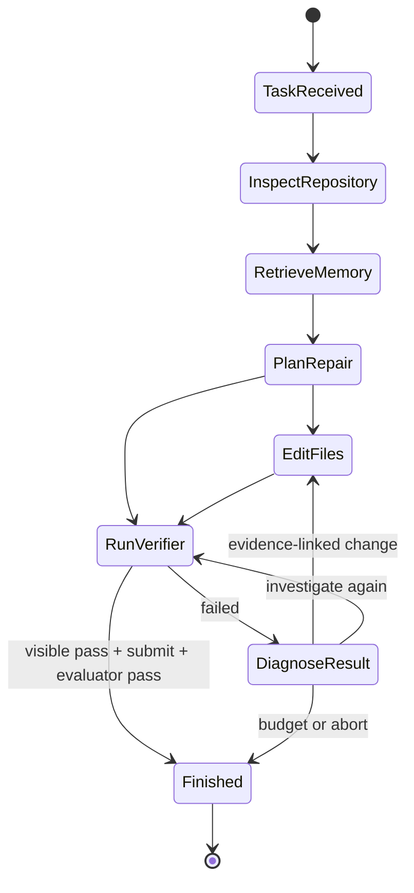

# EvalForge architecture

EvalForge separates probabilistic model decisions from deterministic execution,
verification, and scoring. The orchestrator, not the provider, owns the run.

## Runtime flow



## Components and authority

| Component | Owns | Cannot do |
|---|---|---|
| Provider | Next structured proposal | Set success or execute host commands |
| Orchestrator | State, budgets, routing, termination | Override failing verification |
| Tool layer | Contained reads, patches, commands | Escape the run workspace |
| Visible verifier | Iterative test evidence | Reveal evaluator tests |
| Protected evaluator | Final behavioral score | Guide the repair loop |
| Memory store | Provenance-bearing lessons | Store hidden-test or reference-patch content |
| Trace writer | Append-only event evidence | Infer missing metrics |

## Typed action boundary

Provider output is validated as an `AgentDecision`. Tool actions name exactly
one controlled tool and provide a JSON argument object. A submit decision is
accepted only after the latest visible verifier passed.

The memory-plus-verifier treatment uses a `FailureDiagnosis` with four fields:

- failing test identifier;
- exact evidence excerpts from the latest verifier output;
- causal mechanism;
- proposed next change.

Before applying a patch, the orchestrator checks that the test identifier and at
least one evidence excerpt occur in the latest test output. Failed evidence
checks are traced and the edit is not executed.

## Memory lifecycle

SQLite stores repository, task category, normalized error signature, concise
lesson, repair pattern, failed approach, trace ID, verifier evidence, outcome,
tags, and schema version. FTS5 ranks lexical matches, with repository and
category bonuses. A LIKE fallback supports SQLite builds without FTS5.

Leakage controls:

- current-task memories are excluded;
- only resolved memories are retrieved;
- top-k context is bounded;
- every retrieved memory ID is written to the run summary;
- hidden tests and reference patches are never memory inputs;
- held-out evaluation uses a frozen database.

## Verification layers

The visible command is run during repair. The evaluator tests are copied into a
temporary overlay only after submission, run with the combined evaluator
command, and removed immediately. Resolution requires:

```text
visible tests pass
AND protected evaluator tests pass
AND git diff --check passes
AND termination is tests_passed
```

## Execution boundaries

The local shell tokenizes commands, filters environment variables, restricts
executables and Git subcommands, disables inline Python, contains working
directories, truncates output, and enforces timeouts. It is designed for
reproducibility and accidental-risk reduction.

The Docker verifier adds a read-only container filesystem, a writable bounded
`/tmp`, a bind-mounted task workspace, and `--network none`. It should be used
for real model experiments. Neither boundary is represented as a formal
security proof.

## Artifacts

Every run produces:

- `trace.jsonl`: ordered state, decision, tool, memory, verifier, and termination events;
- `summary.json`: final outcome, budgets, verification, patch, usage, and provenance;
- a fresh Git workspace containing the submitted patch.

Experiment manifests record the config hash, randomized deterministic schedule,
experiment kind, and all run IDs. Aggregate reports are generated from summaries
rather than manually entered numbers.
